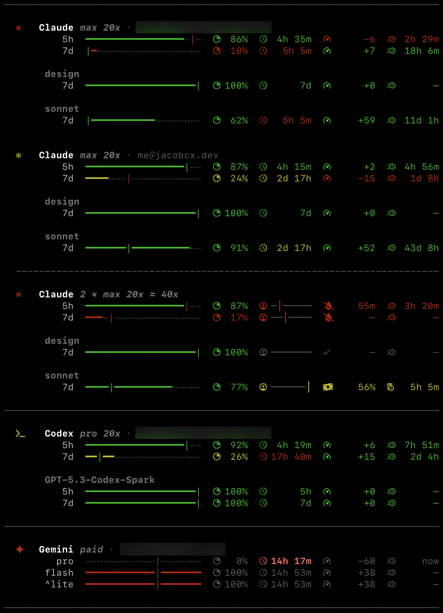

# cq

`cq` checks AI subscription quota, manages accounts and routes compatible local clients through Claude, Codex, Z.ai and Grok. Gemini quota comes from Antigravity. On macOS, CQ can also help you access Dots before regional rollout through a US WireGuard profile, or bring existing Dots from multiple accounts into one ChatGPT sidebar.

**For users and installation agents:** start with the [agent setup and feature guide](docs/agent-installation.md). **Agents: read that guide before installing or changing configuration.** Explain the relevant capabilities, help the user choose, then configure and verify their chosen setup. Users can send their agent this repository link; the guide covers desktop apps and CLIs, account routing, optional features and native ChatGPT integrations.

**Something not working?** Tell your agent what failed in CQ, or use the [bug-report form](https://github.com/jacobcxdev/cq/issues/new?template=bug_report.yml). **Agents investigating a CQ bug or failure: read and follow the [diagnostics and issue-reporting workflow](docs/agent-issue-reporting.md) before changing the setup.** Collect minimal evidence, restore temporary tracing, and show the user the redacted report and attachments before uploading. No special user prompt is needed; reports without logs are welcome.



## Install

Complete installers place an official release binary, install and start the
current-user proxy, and schedule periodic credential refresh. No manual
post-install command is required.

### macOS — Homebrew Cask

```bash
brew install --cask jacobcxdev/tap/cq
```

On macOS 13 and later, the Cask includes the signed CQ Network companion. CQ and
Network share one release version and macOS download bundle. Installation and
upgrades verify that matching payload and automatically upgrade an older
companion. With WireGuard configured, `cq codex network enable` requests macOS approval to route native
ChatGPT traffic without restarting it. See [Native network releases](docs/native-network-releases.md).

Existing formula installations must migrate once so the legacy Homebrew service
cannot conflict with Cask-owned services:

```bash
brew services stop cq
brew uninstall --formula cq
brew install --cask jacobcxdev/tap/cq
```

For legacy Cask hook failures and the first listener-preserving upgrade, see
[Homebrew upgrades](docs/homebrew-upgrades.md).

### Windows — WinGet

```powershell
winget install jacobcxdev.cq
```

WinGet installs CQ, its uninstaller, PATH and Add/Remove Programs metadata, and
both scheduled tasks for the current Windows user without administrator access.

### macOS, Windows, and Linux — Go installer runner

```bash
go run github.com/jacobcxdev/cq/cmd/cq-install@latest
```

The runner resolves its tagged release, downloads and verifies the matching
official CQ asset, then installs the same current-user services as each native
package. Linux requires a functional systemd user manager. Running services
after logout can also require systemd user lingering configured by the host.

Run the same install command to upgrade or repair an installation. Native
package-manager upgrades are also supported:

```bash
brew upgrade --cask cq
winget upgrade jacobcxdev.cq
```

Uninstall through the method that owns the installation:

```bash
brew uninstall --cask cq
winget uninstall jacobcxdev.cq
go run github.com/jacobcxdev/cq/cmd/cq-install@latest uninstall
```

Uninstall removes package-owned executables and services. User configuration,
credentials, cache, history, and logs remain.

## Development and portable binaries

Plain `go install` builds CQ from source for development:

```bash
go install github.com/jacobcxdev/cq/cmd/cq@latest
```

This binary lacks official release provenance and release-time Gemini refresh
material. It does not install or manage services. Direct release archives
contain official binaries, but extraction also does not install or manage
services. Use a complete installer when proxy and refresh lifecycle are wanted.

`headroom-ai` remains a separate, optional integration. CQ installers do not
install Python or optional integrations.

## Quick start

You need at least one signed-in provider. Existing supported local credentials are discovered automatically. To add an account, choose the provider you use; these commands open its browser login:

```sh
cq claude login
cq codex login
cq zai login
```

Each command saves an account. Claude and Codex require `--activate` if you also want to replace the active client credential. A Z.ai browser login becomes preferred by default. Gemini sign-in stays with Antigravity; CQ has no Gemini login command.

Check the providers you configured:

```sh
cq check claude codex             # Select one or more providers
cq check gemini                   # Requires Antigravity credentials
cq check zai                     # Z.ai Coding Plan or Start Plan
cq                               # Check every provider in parallel
cq --refresh check codex          # Fetch fresh quota instead of the cache
cq --json check codex             # Report suitable for a pipe or file
cq --version
```

An unconfigured provider reports that condition; it does not mean the installed proxy is broken. In quota output, `active` identifies the current credential account. Routing can select another eligible account. Use [Reading quota and JSON](docs/usage.md#quota-checks-and-output) for the report fields and unknown values.

Complete installers start the proxy and refresh services. Check their state:

```sh
cq service status --json
cq proxy status --strict --json
```

These commands inspect service/runtime health. Verify a real request from the client after [connecting it](docs/usage.md#connecting-a-client); a healthy listener alone does not establish routed traffic.

## Choose a workflow

| I want to… | Read |
|---|---|
| Find useful features and let an agent configure them with me | [Agent setup and feature guide](docs/agent-installation.md) |
| See remaining quota, reset times and whether my accounts will last | [Quota reports](docs/usage.md#quota-checks-and-output) and [accounts](docs/usage.md#accounts-and-authentication) |
| Keep working across accounts in ChatGPT Desktop, Codex CLI or Claude Code | [Client setup](docs/usage.md#connecting-a-client) and [quota-aware routing](docs/usage.md#client-routing) |
| Keep selected chats within an account group or preserve specialised capacity | [Pools and session bindings](docs/usage.md#capability-policy-and-session-pools), [Cyber access](docs/usage.md#cyber-aware-routing) |
| Keep spare Codex quota for my system account, phone or other clients | [System account reserve](docs/usage.md#system-account-reserve) |
| Use banked resets before expiry or schedule them with my approval | [Codex resets](docs/usage.md#codex) and [Z.ai reset cards](docs/usage.md#zai-coding-plan) |
| Start eligible usage windows earlier instead of waiting for my first task | [Codex priming](docs/usage.md#pins-defaults-and-priming) and [Z.ai priming](docs/usage.md#zai-coding-plan) |
| Give each chat, project or model a suitable plugin/MCP/skill set | [Harness profiles](docs/usage.md#harness-capability-profiles) |
| Use available models, including supported Z.ai models in Codex, without maintaining picker entries by hand | [Model registry](docs/usage.md#model-registry) and [Z.ai setup](docs/usage.md#zai-coding-plan) |
| Access my primary Dot before Dots is available in my region | Use a **US WireGuard profile** with [native ChatGPT routing](docs/configuration.md#native-chatgpt-network-routing). Normal ChatGPT launches work; the multi-account adapter is not required. |
| Use Dots from several accounts in one ChatGPT sidebar | Install [multi-account Dots](docs/dots.md) and launch through CQ. Secondary Dots must already be onboarded; add US WireGuard routing too if regional access requires it. |
| Let Dots coordinate, send them one announcement or share one local message board | [Dot setup and relay](docs/dots.md#setup-and-manual-reminders), [broadcast](docs/dots.md#broadcast), [message board](docs/dots.md#shared-message-board) |
| Show CQ's routed account availability in normal ChatGPT launches | [Usage response adaptation](docs/configuration.md#native-chatgpt-network-routing), a separate opt-in with certificate trust. |
| Find settings, paths, environment variables and examples | [Configuration reference](docs/configuration.md) |
| Diagnose login, quota, routing, upgrade or app failures | [Troubleshooting](docs/troubleshooting.md) |
| Develop, validate or release CQ | [Contributing](CONTRIBUTING.md), [architecture](docs/architecture.md), [releases](docs/releases.md) |

The usage guide covers every public command family. Run `cq COMMAND --help` for that command's exact arguments and supported flags; the index below lists the full command surface. Examples use synthetic addresses and placeholders: replace `EMAIL`, `ACCOUNT_ID`, `ENTRY_ID`, model IDs and absolute paths with values from the corresponding list/status command. Commands that log in, switch, remove, enable, send or consume change state; read their surrounding prerequisites before running them.

For regional Dot access, configure your US WireGuard profile before enabling
CQ Network, complete any macOS approval, and verify native ChatGPT routing.
Your primary Dot's onboarding remains OpenAI's normal native or web flow; CQ
does not add onboarding slots for secondary accounts. [Onboard those accounts
separately](docs/dots.md#install) in a browser or by signing into the native app,
then sync CQ and relaunch through CQ when required. A working CQ proxy alone
does not prove ChatGPT uses the tunnel. See the [agent installation
guide](docs/agent-installation.md#5-verify-the-requested-outcome) for the checks.

## Capabilities and platform support

| Area | Support |
|---|---|
| Quota | Concurrent Claude, Codex, Gemini, Z.ai and Grok checks; multi-account reports, cache, burn history, aggregate pace and availability. Gemini uses Antigravity's platform credential store. |
| Accounts | Claude/Codex OAuth and activation; read-only system discovery; coordinated renewal of eligible managed accounts; Z.ai browser/API-key accounts and billing-route selection; Grok subscription OAuth and borrowed CodexBar discovery. |
| Proxy | Loopback Anthropic Messages and native Codex Responses HTTP/WebSocket routing; local authentication; bounded failover and durable continuity. |
| Routing | Pins/defaults, account allowlists, pools/session bindings, system-account preservation and reserve, priming, leases and rescue. |
| Automation | Explicitly accepted reset schedules, periodic credential refresh, model registry refresh and publication. |
| Models | Anthropic/Codex/Z.ai catalogues, overlays, CQ-owned registry cache and Claude Code publication; compatible Codex clients fetch CQ's model-discovery routes. |
| Native ChatGPT | Optional macOS Dots adapter, scoped harness capability profiles, and signed native network/usage handling. Each integration has separate prerequisites. |
| Operations | Privacy-aware trace JSONL, opt-in payload diagnostics, Stop-hook receipts, canary, isolated candidate validation, durable recovery and legacy endpoint maintenance. |

Official packages target macOS, Windows and Linux on the architectures in each release. Core macOS support includes macOS 12; the signed native network companion requires macOS 13 or later. Dots uses macOS-specific native app contracts. Linux background services require a functional systemd user manager. Windows uses current-user scheduled tasks. Platform support for an external client is separate from CQ's own build support.

## Complete command index

This index is checked against CQ's Kong model and production dispatchers in both directions.

<details>
<summary>Show every command path</summary>

<!-- public-command-index:start -->
```text
cq agent
cq agent install
cq agent uninstall
cq check
cq claude accounts
cq claude login
cq claude remove
cq claude switch
cq codex
cq codex accounts
cq codex canary
cq codex canary start
cq codex canary status
cq codex canary stop
cq codex dots board
cq codex dots broadcast
cq codex dots install
cq codex dots list
cq codex dots order
cq codex dots prime
cq codex dots start
cq codex dots status
cq codex dots stop
cq codex dots sync
cq codex harness bind
cq codex harness chat
cq codex harness disable
cq codex harness enable
cq codex harness explain
cq codex harness export
cq codex harness import
cq codex harness inventory
cq codex harness profile copy
cq codex harness profile list
cq codex harness profile save
cq codex harness profile show
cq codex harness project
cq codex harness skill install
cq codex harness status
cq codex harness unbind
cq codex login
cq codex network
cq codex network disable
cq codex network enable
cq codex network status
cq codex network usage
cq codex network usage disable
cq codex network usage enable
cq codex network usage prepare
cq codex network usage status
cq codex remove
cq codex resets
cq codex resets list
cq codex resets recommend
cq codex resets schedule
cq codex resets schedule add
cq codex resets schedule cancel
cq codex resets schedule disable
cq codex resets schedule enable
cq codex resets schedule mode
cq codex resets schedule remove
cq codex resets schedule set
cq codex resets schedule status
cq codex resets use
cq codex switch
cq codex validate
cq codex validate capture
cq codex validate http
cq codex validate websocket
cq gemini accounts
cq grok
cq grok accounts
cq grok login
cq grok remove
cq grok resets list
cq grok switch
cq models
cq models list
cq models overlay
cq models overlay add
cq models overlay prune
cq models overlay remove
cq models refresh
cq operation
cq operation recover
cq operation status
cq proxy
cq proxy candidate
cq proxy candidate artifact
cq proxy candidate artifact switch
cq proxy candidate client-bearer-barrier
cq proxy candidate client-bearer-barrier refresh
cq proxy candidate prepare
cq proxy candidate receipt
cq proxy candidate receipt show
cq proxy candidate remove
cq proxy candidate start
cq proxy candidate status
cq proxy candidate stop
cq proxy candidate validate-release
cq proxy default
cq proxy default codex
cq proxy endpoint
cq proxy endpoint inspect-legacy
cq proxy endpoint transition-legacy
cq proxy endpoint transition-legacy activate
cq proxy endpoint transition-legacy finalise
cq proxy endpoint transition-legacy prepare
cq proxy endpoint transition-legacy resume
cq proxy endpoint transition-legacy rollback
cq proxy hook
cq proxy hook codex-stop
cq proxy install
cq proxy leases
cq proxy leases redistribute
cq proxy leases invalidate
cq proxy pin
cq proxy pin claude
cq proxy pin codex
cq proxy policy
cq proxy policy apply
cq proxy policy initialise
cq proxy policy pool
cq proxy policy pool rename
cq proxy policy pool set
cq proxy policy pool value
cq proxy policy session
cq proxy policy session bind
cq proxy policy session digest
cq proxy policy session list
cq proxy policy session show
cq proxy policy session unbind
cq proxy policy status
cq proxy prime
cq proxy prime disable
cq proxy prime enable
cq proxy prime status
cq proxy rescue
cq proxy rescue enter
cq proxy rescue exit
cq proxy rescue status
cq proxy reserve
cq proxy reserve clear
cq proxy reserve disable
cq proxy reserve enable
cq proxy reserve set
cq proxy reserve status
cq proxy reserve windows
cq proxy restart
cq proxy start
cq proxy status
cq proxy trace
cq proxy uninstall
cq proxy validate-http
cq refresh
cq service
cq service install
cq service upgrade
cq service restart
cq service status
cq service uninstall
cq zai accounts
cq zai login
cq zai prime disable
cq zai prime enable
cq zai prime now
cq zai prime status
cq zai remove
cq zai resets list
cq zai resets schedule add
cq zai resets schedule cancel
cq zai resets schedule disable
cq zai resets schedule enable
cq zai resets schedule remove
cq zai resets schedule status
cq zai resets use
cq zai route
cq zai switch
cq zai zcode claims claim
cq zai zcode claims list
cq zai zcode resets issue
cq zai zcode resets use
cq zai zcode status
```
<!-- public-command-index:end -->

</details>

## Development

Source builds and the Go installer runner use the Go toolchain required by `go.mod` (currently Go 1.26.1). Official release binaries include release provenance and Gemini refresh material; development builds do not have the same provider-complete release contract.

```sh
go build ./...
go vet ./...
go test -race -count=1 ./...
```

See [CONTRIBUTING.md](CONTRIBUTING.md) for changes and review, [architecture](docs/architecture.md) for implementation boundaries, and [release operations](docs/releases.md) for publication and installed-traffic qualification.

## Licence

MIT

### Grok subscriptions

```bash
cq grok login
cq check grok
cq grok accounts
cq models list --provider grok
cq grok resets list
```

Grok support uses subscription authentication and included quota. CQ does not
accept public xAI pay-as-you-go keys or manage purchased balances. The initial
routing adapter supports models whose authenticated catalogue explicitly selects
the Responses backend. Live subscription/Codex checks cover quota, local tools,
CQ compaction and retained continuation over HTTP and WebSocket;
see [Grok setup and current limits](docs/usage.md#grok-subscriptions).
